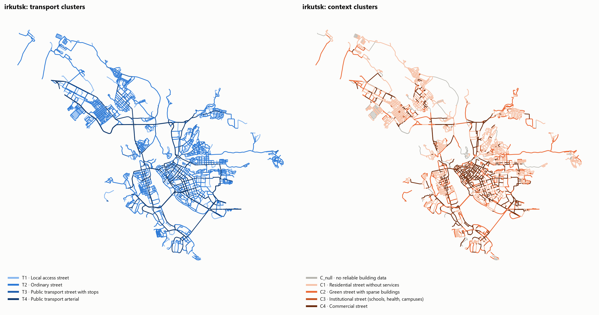
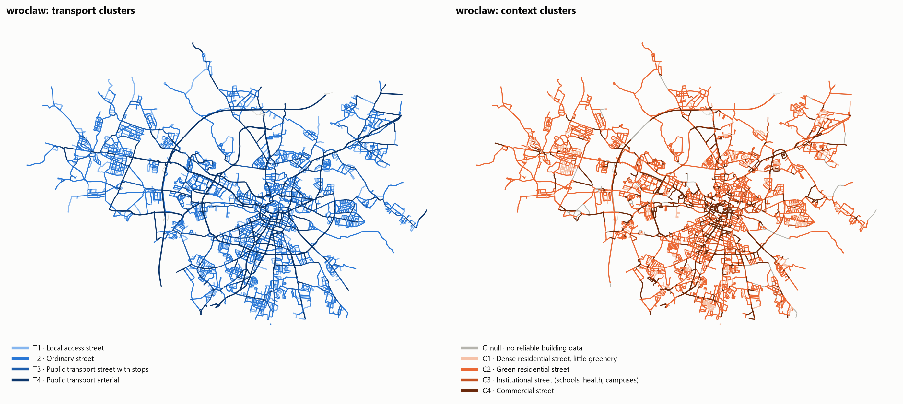
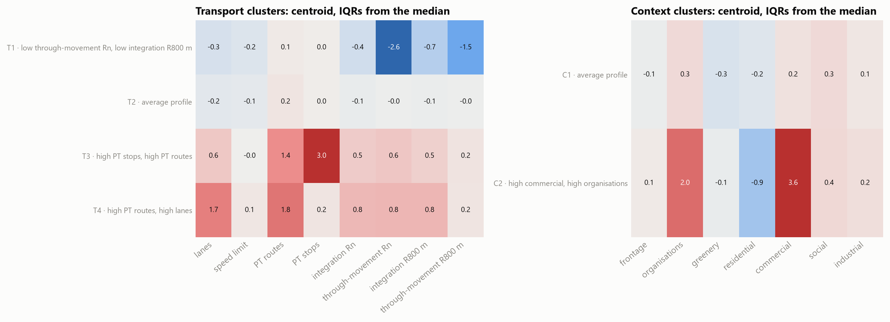
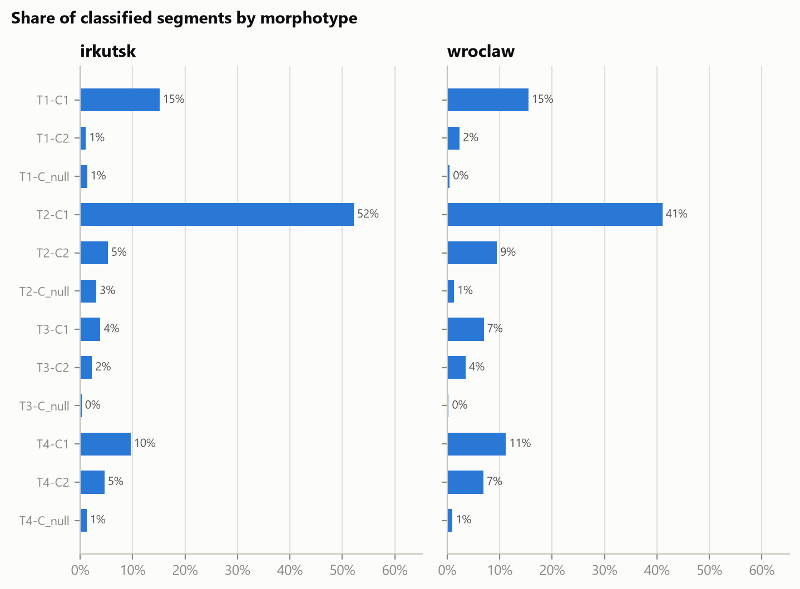

# street-morphotypes

**A data-driven street typology for any city, from OpenStreetMap.**

Every street segment is described twice — as a *link* in the movement network
and as a *place* lined by buildings and activities — and the two descriptions
are clustered independently. The street type (**morphotype**) is the
combination of the two classes, e.g. *"high through-movement, many PT routes ×
continuous street wall, dense commercial"*.

```
OSM network ──► segments ──► space syntax (NAIN, NACH) ─┐
            └─► lanes, speed limit, PT routes & stops ──┴─► transport block ─► KMeans ─► T1…Tk ┐
OSM buildings, POI, land use, green ──► frontage, organisations, greenery,                    ├─► morphotype T × C
                                        building age, functional mix ──► context block ─► KMeans ─► C1…Cm ┘
```

- Works for any place OSM covers: a city name, a point with a radius, or your own polygon.
- Segments run from junction to junction and also end where the street name changes, so two
  differently named streets are never one segment just because no other drivable street meets
  them.
- Space syntax angular segment analysis (NAIN, NACH; global and metric radii), with exact
  agreement to igraph checked by tests.
- Context metrics measured in one-sided strips beyond the carriageway edge; the two
  carriageways of a divided road keep their own sides.
- Functional mix (residential / commercial / social / industrial floor-area shares) estimated
  from open data with a transparent cascade and a data-quality report.
- Everything a user may want to change is in one YAML config; your own layers and survey data
  plug in by column name.
- Three modes: a city's own typology (**local**), one typology for several cities
  (**pooled**), or a saved typology applied to a new city (**apply**).

The method and its assumptions are described in [docs/METHODOLOGY.md](docs/METHODOLOGY.md).

## Example: Irkutsk and Wrocław

Two cities of similar size and population (265 km², 620 000 and 293 km², 670 000), both
with a historic core and large post-war housing estates, processed with the same defaults (only
the national speed-limit defaults and the fixed k in Irkutsk differ). Each run takes 2–5 minutes once the OSM layers are
cached.

| | Irkutsk | Wrocław |
|---|---|---|
| Classified segments (junction to junction) | 4 528 | 7 294 |
| Median segment length | 144 m | 120 m |
| Transport clusters (k, mean silhouette) | 4\*, 0.41 | 4, 0.35 |
| Context clusters (k, mean silhouette) | 4\*, 0.48 | 4, 0.44 |
| Borderline segments | 20 % | 23 % |
| Lanes / speed limit filled from defaults | 61 % / 63 % | 47 % / 22 % |
| Floor area with unknown function | 7.6 % | 3.8 % |

\* In Wrocław the silhouette picks k = 4 in both blocks in every bootstrap subsample. In Irkutsk
it does not separate k = 2 from k = 4 beyond its own noise, and the two-class context partition is
unstable, so k = 4 is fixed in the config
([METHODOLOGY.md § 7](docs/METHODOLOGY.md#7-clustering), `scripts/k_selection.py`).





The **pooled** run puts both cities into one typology. The cluster centroids (in IQRs from the
median) show what each class means; the class composition shows how the two cities differ.





### How robust is the typology?

| Check | Transport block | Context block |
|---|---|---|
| Bootstrap stability, 30 refits on 80 % subsamples (mean ARI): Irkutsk / Wrocław | 0.99 / 0.98 | 0.95 / 0.99 |
| Transfer: a city labelled by the other city's model vs. by its own (ARI) | 0.89–0.91 | 0.67–0.73 |

- The **transport typology is universal**: the four classes found independently in Irkutsk and
  Wrocław (local streets, ordinary streets, PT streets with stops, PT arterials) are practically
  the same classes, and each city's model reproduces the other's.
- The **context typology has the same four types in both cities** — residential streets,
  green streets, institutional streets (schools, health, campuses) and commercial streets — and
  each city's model finds the other's classes (84–100 % of every Wrocław class keep their type
  under the Irkutsk model). The thresholds are relative, though: by Wrocław's standards 39 % of
  Irkutsk's commercial streets and 36 % of its institutional streets are ordinary residential
  streets, while every Wrocław commercial street is commercial by Irkutsk's. A typology meant to
  carry the same design guidance across cities should therefore be a pooled model trained on a
  diverse set of cities, not one city's model.

Details: [METHODOLOGY.md § 9](docs/METHODOLOGY.md#9-validation).

The space syntax implementation was checked against a depthmapX segment analysis of a
47 000-segment network: identical node counts, rank correlation 0.98 for NAIN and 0.92 for NACH.

## Installation

Python 3.10+.

```bash
git clone <repo-url> street-morphotypes
cd street-morphotypes
python -m venv .venv
.venv/Scripts/activate          # Windows;  source .venv/bin/activate on Linux / macOS
pip install -e ".[dev]"
pytest                          # optional: unit tests
```

## Quick start

1. Write a config with at least the study area:

   ```yaml
   # configs/my_city.yaml
   area:
     name: my_city                # folder name for cache and outputs
     mode: place                  # place | point | polygon
     place: "Irkutsk, Russia"
   ```

   or a circle around a point:

   ```yaml
   area:
     name: wroclaw_centre
     mode: point
     point: {lat: 51.1100, lon: 17.0320, radius_m: 3000}
   ```

2. Run:

   ```bash
   street-morphotypes run configs/my_city.yaml
   ```

   This downloads the OSM layers (cached in `cache/<name>/`), builds the feature table, clusters
   both blocks and writes the results to `outputs/<name>/`. Each cached layer remembers the
   extent and tag filters it was downloaded with; change them in the config and the layer is
   downloaded again automatically.

Step by step, the same work is split into:

```bash
street-morphotypes fetch    configs/my_city.yaml   # download OSM layers only
street-morphotypes features configs/my_city.yaml   # network, space syntax, metrics -> features.gpkg
street-morphotypes scan     configs/my_city.yaml   # silhouette for every k + correlated features
street-morphotypes run      configs/my_city.yaml   # clustering + export (reuses saved features)
```

`run` and `scan` reuse `outputs/<name>/features.gpkg` when it exists; pass `--recompute` after
changing a metric setting.

A config can extend another one and override a few settings — handy for experiments:

```yaml
# configs/experiments/irkutsk_context_k4.yaml
extends: ../irkutsk.yaml
paths: {output_dir: outputs/experiments/context_k4}
clustering:
  context: {k: 4}
```

### Several cities: one typology

```yaml
# configs/pooled.yaml
mode: pooled
name: irkutsk_wroclaw
cities: [configs/irkutsk.yaml, configs/wroclaw.yaml]
clustering:            # optional overrides of the clustering section
  transport: {k: 4}
```

```bash
street-morphotypes run configs/pooled.yaml
street-morphotypes apply configs/another_city.yaml --model outputs/irkutsk_wroclaw/model.joblib
```

## Outputs

`outputs/<name>/`

| File | Content |
|---|---|
| `morphotypes.gpkg` | layer `segments`: every study-area segment with all features and labels; layer `study_area` |
| `morphotypes.xlsx` | `segments`, `morphotypes`, `morphotype_matrix`, `transport_profiles`, `context_profiles`, `borderline`, `k_scan_*`, `correlations`, `data_quality`, `config` |
| `figures/*.png` | k selection, silhouette diagrams, cluster profiles, morphotype matrix, maps of clusters, morphotypes, space syntax and borderline segments |
| `model.joblib` | the fitted typology (scalers, KMeans, GMM, names) for `apply` |
| `summary.json` | k, features, mean silhouette, names, counts, data quality |
| `features.gpkg` | the feature table before clustering |

Label columns: `T_cluster`, `T_name`, `C_cluster` (−1 = `C_null`, unreliable building data),
`C_name`, `morphotype` (`T2-C1`), `morphotype_name`, `*_confidence` (GMM posterior of the assigned
cluster), `*_silhouette`, `borderline` (low silhouette or confidence in either block — check
these by hand).

## Web map

`web/` is a static page (MapLibre, Positron basemap) with a city switch and every layer of a run:
transport metrics, context metrics and the final morphotypes.

- **Data follow your runs.** After `street-morphotypes run`, `web/data/` is rebuilt from every run in
  `outputs/`: a city that is no longer among the outputs disappears from the page. For each city the
  local run is used, otherwise the pooled run that contains it. Rebuild by hand with
  `street-morphotypes web`. Runs with `output: {web: false}` (experiments, test areas) are left out.
- **Typology switch.** A city is also shown with every other typology that labelled it: another
  city's model (`street-morphotypes apply`) and the pooled runs that contain it. For each one the page
  shows on the map which streets change class against the city's own typology, with the agreement (ARI).
- **Basemap key.** Copy `web/config.example.js` to `web/config.js` (ignored by git) and put there a raster
  tile URL with your key (`basemapTiles`, e.g. CARTO Positron) or a MapTiler key; without either the page uses
  the keyless CARTO Positron style.
- **View locally.** Open `web/index.html` in a browser, or serve it: `python -m http.server -d web 8000`.
- **GitHub Pages.** `.github/workflows/pages.yml` publishes `web/` on every push to `main` that changes it.
  Set *Settings → Pages → Source* to *GitHub Actions* and add the repository secret `BASEMAP_TILES`
  (or `MAPTILER_KEY`); the workflow writes `web/config.js` from it. Restrict the key to your Pages domain: a browser key is
  always visible to visitors.

## Features

| Block | Column | Meaning |
|---|---|---|
| transport | `ss_nain_<r>` | normalised angular integration at radius r (`n` = global, or metres) |
| transport | `ss_nach_<r>` | normalised angular choice at radius r |
| transport | `lanes` | lanes across the street (both carriageways of a divided road) |
| transport | `maxspeed` | speed limit, km/h |
| transport | `pt_routes` | public transport routes along the segment |
| transport | `pt_stops_per_100m` | PT stops per 100 m |
| context | `frontage` | share of the segment length lined by buildings (street wall) |
| context | `poi_per_100m` | organisations per 100 m |
| context | `green_m2_per_100m` | green area per 100 m |
| context | `building_age_median` | median building age (dropped when OSM has too few dates) |
| context | `fn_residential`, `fn_commercial`, `fn_social`, `fn_industrial` | floor-area shares of functions |

Which of them enter the clustering is set in `clustering.transport.features` and
`clustering.context.features`. Other columns (`ss_choice_*`, `ss_nc_*`, `green_share`,
`fn_unknown`, `gfa_total_m2`, `lanes_imputed`, …) are kept in the outputs for interpretation.

## Configuration

A city config is merged on top of
[`src/street_morphotypes/defaults.yaml`](src/street_morphotypes/defaults.yaml), which documents
every option. Mappings merge key by key; lists replace. Sections:

| Section | What it controls |
|---|---|
| `area` | study area, CRS, network buffer for space syntax, context margin |
| `overpass` | Overpass endpoints, tried in order (the first one answering a probe is used) |
| `layers` | `osm`, `file` or `none` for each input layer |
| `network` | highway classes, intersection consolidation, minimum length, divided-road detection |
| `space_syntax` | radii, angle unit, parallel workers |
| `metrics` | per-metric buffer widths, OSM tag filters, defaults for missing tags, building function rules |
| `extra_features` | your own segment attributes and the block each joins |
| `clustering` | features per block, k or `auto`, ordering feature, thresholds |
| `names` | manual names for clusters and morphotypes |
| `output` | which outputs to write |

Settings are validated on load: a typo such as `bufer_m` stops the run with a clear message.

## Bring your own data

Any input layer can come from a file (GeoPackage, Shapefile, GeoJSON; any CRS):

```yaml
layers:
  buildings: {source: file, path: data/buildings.gpkg, layer: buildings}
```

| Layer | Geometry | Columns read (all optional unless noted) |
|---|---|---|
| `network` | lines split at junctions | `highway`, `lanes`, `maxspeed`, `oneway`, `name`, `osm_id`; set `id_column` to keep your own segment ids |
| `buildings` | polygons | `levels`, `height_m`, `year_built`, `function` (`residential`/`commercial`/`social`/`industrial`/`other`), `building` (OSM-style type) |
| `pois` | points or polygons | `category` (same values as `function`); every feature counts as an organisation |
| `landuse` | polygons | `category` (same values as `function`) |
| `green` | polygons | — |
| `transit_routes` | lines | `route_key` (**required**: one value per route) |
| `transit_stops` | points | — |

A buildings layer with `function` skips the OSM function cascade; with `year_built` the building
age metric becomes available even where OSM has no dates.

Survey data and other attributes are attached to segments with `extra_features`:

```yaml
extra_features:
  - path: data/traffic_counts.gpkg
    columns: {car_flow: transport, ped_flow: transport, survey_note: none}
    join: spatial          # lines: longest overlap; points: nearest; polygons: containing the midpoint
    max_distance_m: 15
```

Columns assigned to `transport` or `context` are added to that block's clustering features;
`none` only carries the column to the outputs. With a network from a file you can also join by
id (`join: id`, `id_column: …` matching `layers.network.id_column`). A user network is also
merged through pseudo-junctions; a merged segment keeps all its source ids and receives the mean
of their numeric values.

## Adding a metric

Subclass `SegmentMetric` (see `src/street_morphotypes/metrics/`), return a frame indexed by
`seg_id`, add a config section and list the class in `metrics/__init__.py:METRICS`. Side strips,
spatial pairing and per-100 m normalisation are available from `MetricContext`.

## Project layout

```
src/street_morphotypes/
  config.py, defaults.yaml   configuration schema and defaults
  area.py                    study area and download extents
  data/                      Overpass client, OSM / file layers, cache
  network/                   segments, divided-road twins, space syntax
  metrics/                   transport and context metrics, user features
  clustering/                preprocessing, block clustering, morphotypes, saved model
  features.py, pipeline.py   feature table, local / pooled / apply runs
  io/, viz/                  GeoPackage / Excel export, figures
  io/web.py                  data for the web map
  cli.py                     command line
configs/                     example city and pooled configs; experiments/ for variants
scripts/
  stability.py               bootstrap stability of a run's clusters
  compare_runs.py            agreement between two labellings of a city (local / apply / pooled)
  validate_depthmapx.py      space syntax check against a depthmapX export
  reproduce_case_study.sh    every number of the Irkutsk–Wrocław case study, in one go
docs/METHODOLOGY.md          method, assumptions, references
web/                         web map: index.html, app.js, styles.css, data/ (generated)
tests/                       unit tests
```

## Data and licence

Map data © OpenStreetMap contributors, available under the Open Database Licence (ODbL).
Code: MIT.
